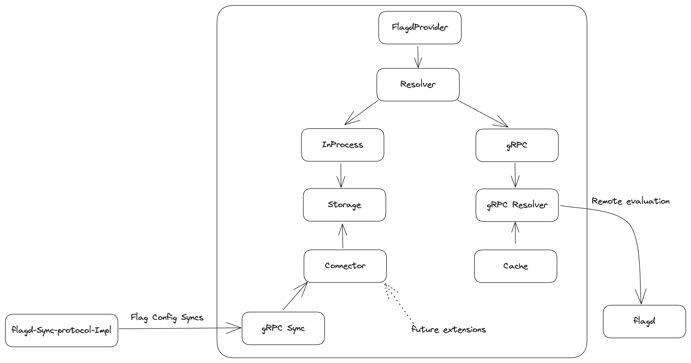

# flagd Provider for OpenFeature

Given below is the architecture of the provider implementation.



## Building

`mvn compile` will pull the `schemas` and `sync` submodule, and build the gRPC resources.
Note that in some editors, you will need to disable some automatic compilation options to prevent your editor from cleaning them.
In vscode for instance, the following settings are recommended:

```json
{
  "java.configuration.updateBuildConfiguration": "automatic",
  "java.autobuild.enabled": false,
  "java.compile.nullAnalysis.mode": "automatic"
}
```

## End-to-End Tests

The [flagd-testbed](https://github.com/open-feature/flagd-testbed) scenarios run through the
Provider TCK, which starts the testbed itself (Docker required):

```
mvn -Ptck -pl providers/flagd -am test
```

See [Provider conformance (TCK)](README.md#provider-conformance-tck) for what runs and how.

If test-harness is being updated, commit the changes before running `mvn`.
Otherwise, uncommitted changes will be overridden by maven test plugins.
